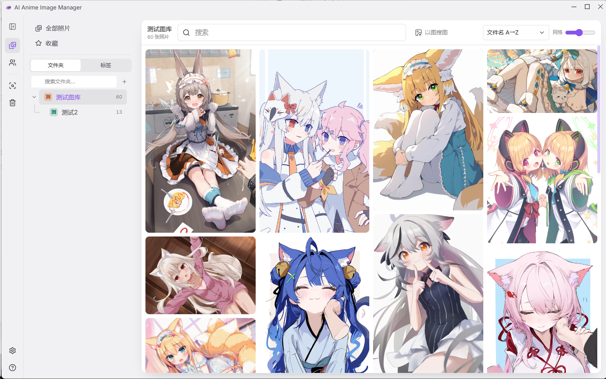
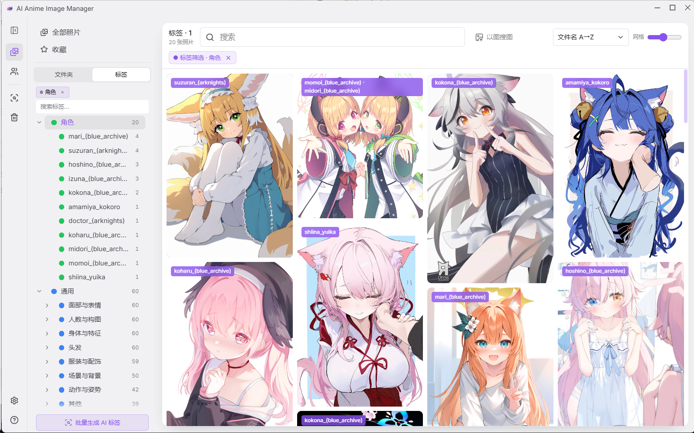

# AI Anime Image Manager（本地版 · 已冻结）

> **一句话**：本地动漫图库管理器：自动打 Danbooru 标签、标签中文化、以图搜图、回收站；全部本地运行、不上传图片。
>
> 基于上游 [Uyoung666/ai-image-manager](https://github.com/Uyoung666/ai-image-manager) v2.2.3（MIT，© 2025 Luan Roger）的**个人自用修改版**。
>
> ⚠️ **本版已冻结**（2026-10-18 最后一次更新）。后续维护在 **WD** 与 **NEXT** 两个仓库。

## 维护状态（2026-10-18）

本版**冻结**，只保留历史版本；**除非出现严重问题（数据损坏、无法启动、核心功能完全不可用），否则不再更新**。

- 日常的使用调整、界面改动、模型升级，都只在 **WD 版**（原 LAN 版）与 **NEXT 版**继续做；
- 需要新功能的话，请直接换用 WD 或 NEXT —— 两版与本地版功能基本重合，只是打标模型不同；
- 本仓库已设为**只读归档**；如果以后真的需要在此版本上修 bug，仓库所有者可以随时取消归档再改；
- 已有的安装包、历史版本仍可正常下载与使用（见下方 Releases / 网盘）。

## 三个版本怎么选

| 版本 | 打标模型 | 局域网/手机 | 状态 |
|---|---|---|---|
| **本地版**（本仓库） | WD14（在安装包里） | 无 | **已冻结** |
| WD（`AI-Anime-Image-Manager-WD`） | WD14（在安装包里） | **有** | 持续维护 |
| NEXT（`AI-Anime-Image-Manager-NEXT`） | PixAI Tagger v1.0（和 NEXT 安装包放同一处） | **有** | 持续维护 |

> 三个版本**语义搜索**都是中文 CLIP（在安装包里），**角色识别**都用 CCIP（外置模型，三版共用一份）。
>
> ⚠️ **文档里的速度/倍率都是本机实测**（RTX 4070 Ti SUPER，图库约 7.7 万张），**不代表所有电脑**，仅供参考。

## 怎么装（2 步）

1. **装本体**：双击 `AI Anime Image Manager-2.2.3-20261018.msi`（713 MB，WD14 模型已在包内），按向导走；
2. **打开**：开始菜单里的「AI Anime Image Manager」，先选一个图库文件夹。

> 角色识别想用的话，再放一次 CCIP 模型：见 [CCIP模型安装说明.md](CCIP模型安装说明.md)。

## 下载

| 内容 | 地址 |
|---|---|
| **安装包**（三个版本） | <https://pan.baidu.com/s/1jDBvv4tL9v5_BgYhRDJcGQ?pwd=6666> 提取码 `6666` |
| **CCIP 角色识别模型**（三版共用，339 MB，单独一份） | 见 [CCIP模型安装说明.md](CCIP模型安装说明.md) |

- 历史版本在 [Releases](https://github.com/ASakurafoxA/AI-Anime-Image-Manager/releases)（一版一个 tag，旧版不会被覆盖）。

## 主要功能

| | 能力 | 一句话说明 |
|---|---|---|
| 🏷️ | **自动打标** | 导入即打 Danbooru 动漫标签（WD14，词表 10,861），标签全中文 |
| 🌳 | **标签树** | 角色 / 通用二级分类，可改名、改色、拉黑、只显示有图的标签 |
| 🔍 | **搜索** | 中文文字搜、以图搜图、日期/文件夹/标签筛选、`Ctrl+K` 全局搜索 |
| 🎭 | **角色识别** | 找出"同一个人"的图并命名（CCIP 外置模型，可选） |
| ♻️ | **重复检测** | 找重复/相似图，支持暂停与断点继续 |
| 🗑️ | **回收站** | 删除先进回收站，默认留 30 天，可恢复 |
| 🖼️ | **浏览** | 瀑布流、大图查看、点空白退出、收藏 |

> 细节见 **[功能说明.md](功能说明.md)** 与 **[使用说明.md](使用说明.md)**。

## 界面截图

 <em>主界面：左边标签树，右边瀑布流</em>

 <em>标签树：角色 / 通用分类，全中文名</em>

## 更新了什么

见 [CHANGELOG.md](CHANGELOG.md)。功能细节见 [功能说明.md](功能说明.md)。

## 许可

本项目代码 **MIT**（见 [LICENSE](LICENSE)）；第三方模型许可见 [MODELS.md](MODELS.md)。
